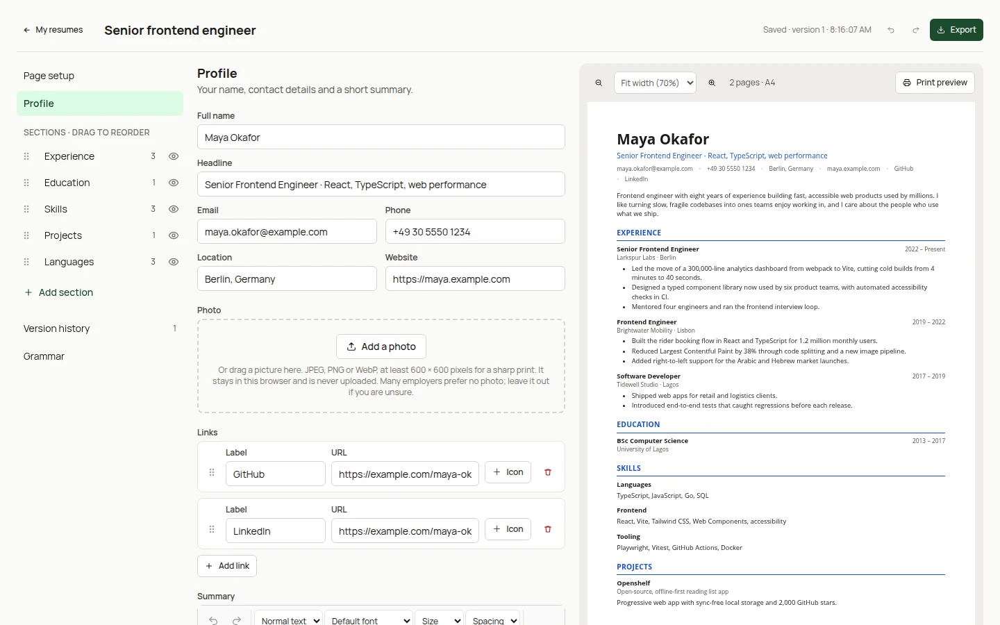

<div align="center">


# Open Vitae

**A private resume builder that runs entirely in your browser.**

_Pronounced OH-pən VEE-tie (/ˈoʊ.pən ˈviː.taɪ/). Vitae is Latin for “of life”, as in curriculum vitae._

[Website](https://kanilabs.github.io/open-vitae/) · [Open the app](https://kanilabs.github.io/open-vitae/app/) · [Documentation](docs/README.md) · [The name and the logo](docs/15-brand-and-story.md)

</div>

A free, open-source resume builder. No account, no server, no tracking. Built for left-to-right, right-to-left and mixed-direction resumes.

<p align="center"></p>

> **Version 1.0.0**, the first release. See what it does in the [changelog](CHANGELOG.md), and what may come next in the [roadmap](docs/06-roadmap.md).

## Contents

- [Why Open Vitae](#why-open-vitae)
- [Quick start](#quick-start)
- [Run with Docker](#run-with-docker)
- [Scripts](#scripts)
- [Project layout](#project-layout)
- [Documentation](#documentation)
- [Contributing](#contributing)
- [Security and privacy](#security-and-privacy)
- [Licence](#licence)

## Why Open Vitae

- **Private by design.** Your resume, photo and fonts stay in your browser. There is no backend.
- **Nothing is lost.** Every save becomes a dated version you can restore or download.
- **Arrange freely.** Drag sections and entries with a mouse, finger or the keyboard.
- **Real bidirectional text.** Persian, Arabic, Kurdish, Urdu and Hebrew sit next to English correctly.
- **Print-accurate pages.** A4 by default, plus Letter, A3, A5, B5, Legal, Tabloid and Executive.
- **Open formats.** Export to PDF, Word, InDesign (ICML), PNG, JPG and SVG; import and export JSON, CSV, Excel and Markdown; templates to fill in.
- **Your language.** Use the app in English, فارسی, العربية or کوردی; write resumes in any language and calendar.
- **Installable.** Works offline as a progressive web app, and asks before updating.
- **Works with AI assistants.** A [published JSON Schema](public/schema/resume.schema.json) and an [AI skill](skills/README.md) let assistants write resumes you can import.

## Quick start

Requires Node.js 22 or newer.

```bash
npm install
npm run dev
```

Open <http://127.0.0.1:5173>.

First time in a fresh copy? Set up the branches:

```bash
bash scripts/init-git-flow.sh
```

## Run with Docker

```bash
docker compose up --build              # production build at http://127.0.0.1:8080
docker compose --profile dev up dev    # hot-reload dev server at http://127.0.0.1:5173
docker compose --profile grammar up    # also run a private LanguageTool server for grammar checking
```

Both containers bind to localhost only, drop all Linux capabilities and run as a non-root user. Details in [Docker](docs/05-docker.md).

## Scripts

| Command              | What it does                                                  |
| -------------------- | ------------------------------------------------------------- |
| `npm run dev`        | Start the dev server                                          |
| `npm run build`      | Type-check and build to `dist/`                               |
| `npm run preview`    | Serve the production build locally                            |
| `npm run check`      | Type-check, lint, format check and unit tests                 |
| `npm run test`       | Unit tests                                                    |
| `npm run lint`       | ESLint                                                        |
| `npm run format`     | Format with Prettier                                          |
| `npm run site:build` | Assemble the landing page (and the built app) in `dist-site/` |
| `npm run brand`      | Regenerate the logo SVGs                                      |
| `npm run schema`     | Regenerate `public/schema/resume.schema.json`                 |

## Project layout

```text
open-vitae/
├── .claude/commands/     Implement, review and eval commands for Claude Code
├── .github/              CI, Pages deploy, release workflow, templates
├── assets/brand/         Logo, icons, wordmarks and social image (generated)
├── docker/               nginx config and security headers
├── docs/                 Full documentation
├── public/               Static assets copied as-is, including the resume JSON Schema
├── scripts/              Git flow helpers, brand generator, site assembly
├── site/                 The landing page (GitHub Pages root)
├── skills/               AI skill for writing Open Vitae resumes
└── src/
    ├── components/       Reusable React components (ui/, library/, workspace/, resume/)
    ├── config/           Page sizes, fonts, layout limits, section kinds
    ├── i18n/             Interface languages and translations
    ├── pwa/              Install, offline and update handling
    ├── lib/              Utilities, sanitiser, migrations, storage/
    ├── samples/          The eight sample resumes
    ├── schema/           Zod schema: the resume data model
    ├── stores/           App state and autosave
    └── types/            Public type exports
```

## Documentation

1. [Documentation home](docs/README.md)
2. [Getting started](docs/01-getting-started.md)
3. [Architecture](docs/02-architecture.md)
4. [Git flow](docs/03-git-flow.md)
5. [Release process](docs/04-release-process.md)
6. [Docker](docs/05-docker.md)
7. [Roadmap](docs/06-roadmap.md)
8. [Data and storage](docs/07-data-and-storage.md)
9. [The editor](docs/08-editor.md)
10. [Rich text editor](docs/09-rich-text-editor.md)
11. [Fonts and right-to-left text](docs/10-fonts.md)
12. [Pages and printing](docs/11-pages-and-printing.md)
13. [Photos and icons](docs/12-photos-and-icons.md)
14. [Import and export](docs/13-import-and-export.md)
15. [Languages, offline use and accessibility](docs/14-languages-and-offline.md)
16. [The name, the logo and the brand](docs/15-brand-and-story.md)

## Contributing

Read [CONTRIBUTING.md](CONTRIBUTING.md) and the [git flow guide](docs/03-git-flow.md). Changes are listed in the [changelog](CHANGELOG.md).

## Security and privacy

Open Vitae collects nothing. The only outside request the app can make is to Google Fonts, and only when you pick a Google font. Optional grammar checking talks only to a LanguageTool server on your own site. To report a vulnerability, see [SECURITY.md](SECURITY.md).

## Licence

[GPL-3.0-or-later](LICENSE). You may use, study, share and change this software; changed versions you distribute must stay under the same licence.

Icon sets keep their own licences, listed in [Photos and icons](docs/12-photos-and-icons.md#icon-sets-and-licences). Bundled fonts keep their own licences: Manrope (SIL Open Font License 1.1), Sahel and Estedad (see the licence files that `npm run fonts:fetch` places in `public/fonts`).
