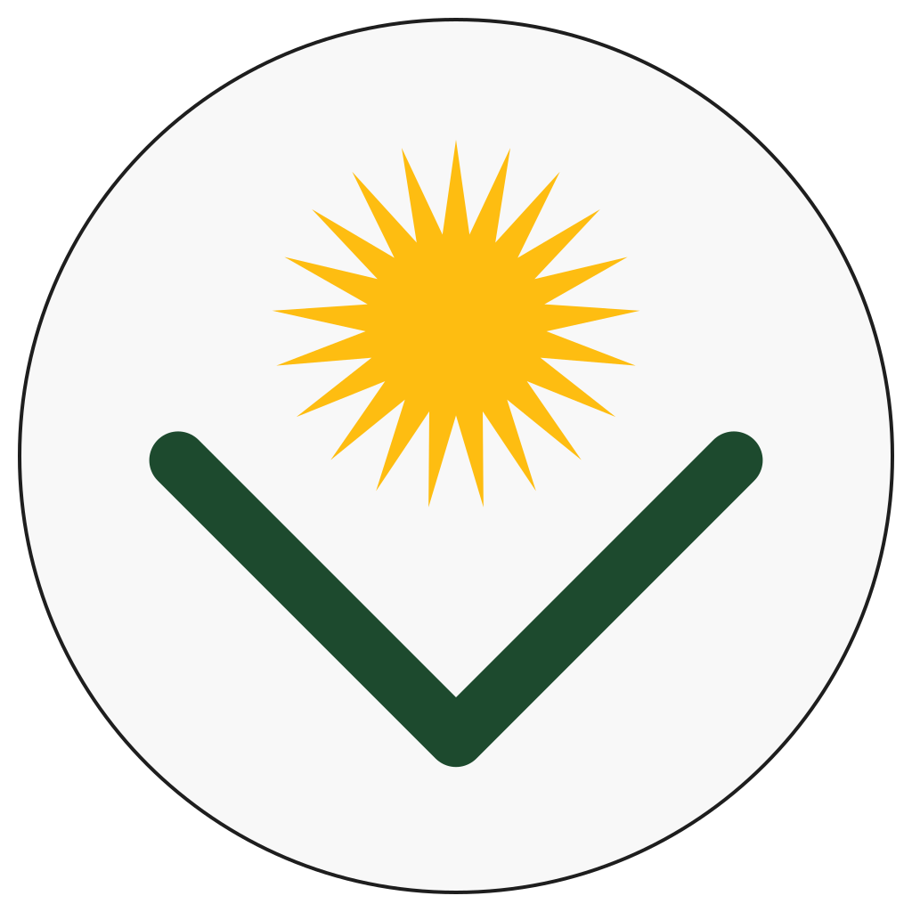

# The name, the logo and the brand

Previous: [Languages, offline use and accessibility](14-languages-and-offline.md) · [Docs home](README.md) · [Main README](../README.md)

## Contents

- [The name](#the-name)
- [The logo](#the-logo)
- [Colours and type](#colours-and-type)
- [Logo files](#logo-files)
- [Usage rules](#usage-rules)
- [The landing page](#the-landing-page)
- [Sources](#sources)

## The name

**Open Vitae** (pronounced _OH-pən VEE-tie_) joins _open_, as in open source and open to everyone, with _vitae_, from _curriculum vitae_, Latin for “the course of a life”. A resume is that course, written down for the next step.

## The logo

The logo joins two Kurdish signs, as the logos of its sibling projects [Roj](https://github.com/kanilabs/roj) and [Zimanyar](https://github.com/kanilabs/Zimanyar) do: a sign of **deq** and **Roj**, the sun of the flag of Kurdistan.

### Deq

Deq (_xał_) is the traditional tattooing of the Kurds, hand-poked lines, dots and shapes, worn above all by women on the face and hands. [1] Common designs include lines, stars, suns, semicircles, diamonds and crosses, and facial deq was believed to protect against evil and bring health and fertility. [1] The practice declined during the twentieth century and is being revived as an expression of Kurdish identity. [1] [2]

One description of deq fits a resume closely: a woman's deq “can be seen as a diary” of her life. [1] Open Vitae keeps the same kind of record, on paper instead of skin.

### The chin chevron: the V of Vitae

Chin markings are among the most familiar places for deq, and the chevron (a V) is one of its basic strokes. The logo draws that chevron with the modules of [Deq](https://github.com/kanilabs/deq), the open design system of deq shapes: two 45-degree strokes from one point, with round ends. [3] The chevron is also the **V** of **Vitae**.

When the deq artist Fatê Temel gave herself her first deq, on her chin, it was a sun. [2] The logo puts the two together.

### Roj: the sun of the flag

The Kurdish Sun, _Roj_ (ڕۆژ), is a burning golden sun and the national emblem of the Kurds. [4] Its 21 rays were first designed by Mehrdad Izady; the sun and the number 21 hold religious and cultural importance in Yazidism, Yarsanism and Alevism, and the rays were chosen to symbolise the rebirth of the Kurdish nation, identity and dignity. [4] [5] The number 21 also recalls 21 March, Newroz. [4]

In the logo, Roj shines in the opening of the V, in the place where a deq sign would carry its dot, as the sun does under the crown in the Zimanyar logo: the course of a life, lit by the sun. The sun is the same emblem drawing the Roj and Zimanyar logos use, in the gold of the flag, unchanged. The Zimanyar brand guide records it as taken from Wikimedia Commons in the public domain.

### A family of logos

| Roj                                        | Zimanyar                                              | Open Vitae                                                    |
| ------------------------------------------ | ----------------------------------------------------- | ------------------------------------------------------------- |
| A calendar: a deq sign with the rising sun | A grammar helper: the deq crown with the sun under it | A resume builder: the deq chevron with the sun in its opening |

All three share the white disc with a thin rim, the flat line and the gold of Roj.

## Colours and type

| Name | Hex       | Use                                                 |
| ---- | --------- | --------------------------------------------------- |
| Deq  | `#1D4A2E` | The chevron; the app's brand colour, buttons, links |
| Sun  | `#FEBD11` | Roj; small accents only, never text                 |
| Face | `#F8F8F8` | The disc; page backgrounds                          |
| Rim  | `#1E1E1E` | The disc outline; one-colour icon                   |
| Ink  | `#1C1917` | Text                                                |

Deq green on the face colour has a contrast of about 9.5 : 1, so it is safe for text and controls. Gold is decoration: it does not reach text contrast on white.

The app and the landing page use **Manrope** for Latin script and **Sahel** and **Estedad** for Arabic script, the same fonts as resumes.

## Logo files

All logo SVGs are written by [`scripts/brand/make-logo.mjs`](../scripts/brand/make-logo.mjs) from one geometry definition on the Deq 24-unit grid. Never edit the SVGs by hand: change the script, then run `npm run brand` and render the PNGs with `npx -y -p puppeteer node scripts/brand/render-icons.mjs`.

| File                                           | Use                                                                              |
| ---------------------------------------------- | -------------------------------------------------------------------------------- |
| `assets/brand/logo.svg`                        | Master: disc with rim. App header, README, store and social images; 48 px and up |
| `assets/brand/logo-favicon.svg`                | 16 to 32 px: paper rounded square, heavier stroke (also `public/favicon.svg`)    |
| `assets/brand/logo-symbolic.svg`               | One colour (`currentColor`): pinned tabs, monochrome toolbars                    |
| `assets/brand/logo-maskable.svg`               | Android and PWA maskable icon: full-bleed paper, mark inside the safe zone       |
| `assets/brand/png/logo-*.png`                  | 16 to 1024 px                                                                    |
| `assets/brand/wordmark-light.png`, `-dark.png` | Logo with the name and tagline                                                   |
| `assets/brand/social-preview.png`              | 1280 × 640 card for GitHub and link previews (also in `public/`)                 |
| `public/favicon.ico`                           | 16, 32 and 48 px                                                                 |
| `public/icons/`                                | PWA icons 192 and 512, maskable 512, Apple touch icon 180                        |

Set the repository's social preview on GitHub (Settings › General › Social preview) to `assets/brand/social-preview.png`.

## Usage rules

- Keep clear space around the logo of at least a quarter of its width.
- Use the favicon variant below 48 px; the disc variants from 48 px.
- On dark or busy backgrounds use a variant with its own paper (disc, favicon or maskable).
- Do not recolour, rotate, stretch or outline the logo, redraw the sun with other rays, or separate the sun from the chevron.
- Write the name as **Open Vitae**: two words, both capitalised.

## The landing page

The landing page lives in [`site/`](../site/): plain HTML and CSS, no scripts and no requests to other sites. The GitHub Pages workflow builds the app with `VITE_BASE=/<repository>/app/`, then [`scripts/build-site.mjs`](../scripts/build-site.mjs) puts the landing page at the root, copies the logo, favicons and social image beside it, and places the app under `app/`. Run `npm run build` and `npm run site:build` to assemble `dist-site/` locally.

The screenshots in `site/images/` are taken from the running app.

## Sources

1. “Deq (tattoo)”, Wikipedia. https://en.wikipedia.org/wiki/Deq_(tattoo)
2. Jaclynn Ashly, “The deq tattooist: Preserving the ink of a disappearing culture”, Al Jazeera, 8 January 2023. https://www.aljazeera.com/features/longform/2023/1/8/deq-the-tattooist-preserving-the-ink-of-a-disappearing-culture
3. Deq: traditional Kurdish tattoo shapes as an open, parametric design system (grid and module rules in `docs/design/shape-spec.md`). https://github.com/kanilabs/deq
4. “Kurdish Sun”, Wikipedia. https://en.wikipedia.org/wiki/Kurdish_Sun
5. “Flag of Kurdistan”, Wikipedia. https://en.wikipedia.org/wiki/Flag_of_Kurdistan

---

Previous: [Languages, offline use and accessibility](14-languages-and-offline.md) · [Docs home](README.md) · [Main README](../README.md)
